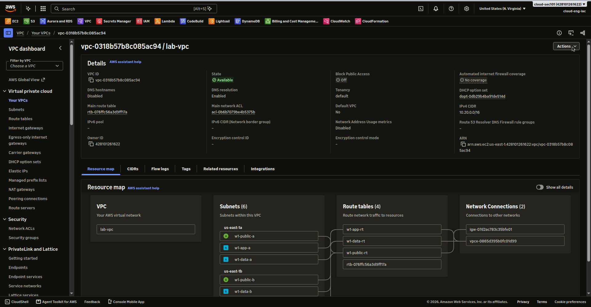
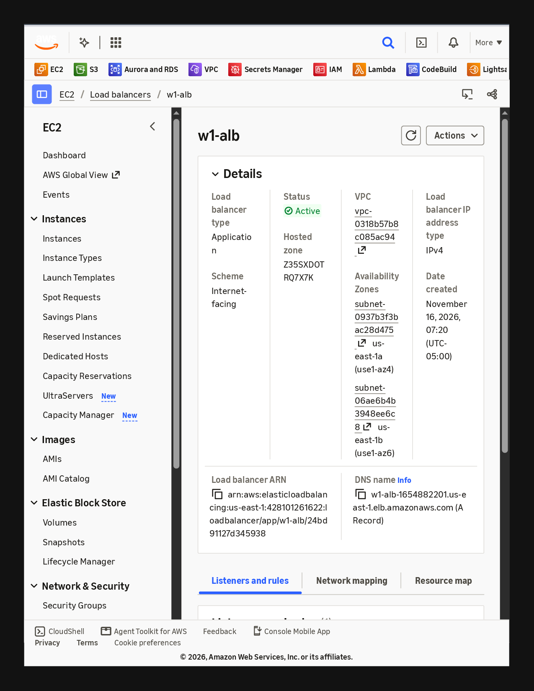
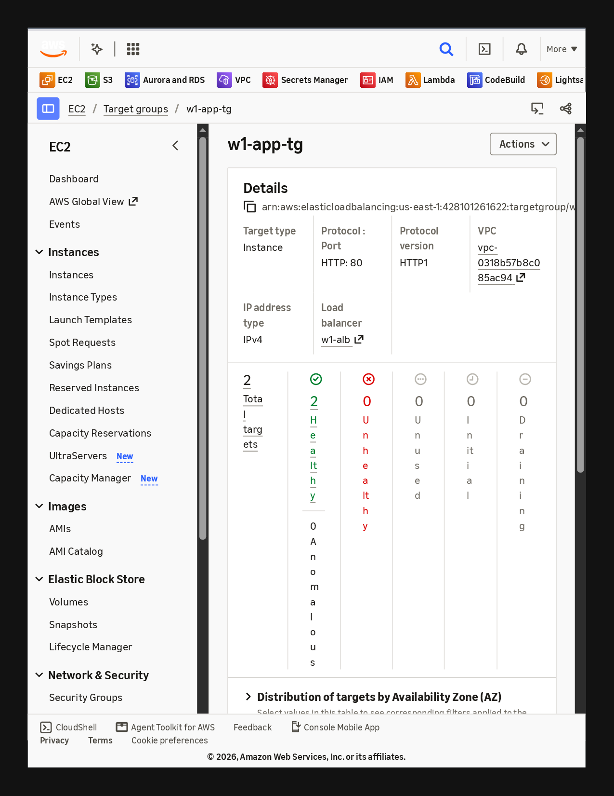

# Cloud Engineer 30-Day Program

A 30-day, build-first program to revisit and prove senior-level cloud engineering skills across AWS, Azure, infrastructure as code, and Kubernetes. Every day produces working infrastructure, the exact commands and scripts that built it, documented evidence, and a spoken interview drill. No tutorials that end in nothing: if it is in this repo, it was built and verified.

**The full step-by-step guide for all 30 days is [week1/README.md](week1/README.md).**

## How each day works

1. **Build** the day's piece of the architecture from the guide's exact commands.
2. **Verify** the resulting state live (resources, settings, health), never just the command output.
3. **Prove it**: notes, policies, scripts, and AWS Console screenshots filed in the day's folder.
4. **Drill**: a word-for-word spoken script for the interview question the day answers.

## Week 1: one AWS reference architecture, built day by day

A three-tier VPC (10.20.0.0/16) across two availability zones, built to production patterns on a $10/month budget guard: IAM least privilege, private app and data tiers, an ALB fronting an Auto Scaling group, and RDS Multi-AZ with failover and restore tests (Day 4, run pending).

| Day | Build | Status |
|---|---|---|
| 1 | IAM deep refresh: hand-written policies, permission boundary and SCP templates, budget alert | Complete, evidence in [week1/iam](week1/iam) |
| 2 | VPC networking: 6 subnets, per-tier routing, NAT, chained security groups, S3 endpoint, flow logs | Complete, evidence in [week1/network](week1/network) |
| 3 | Compute and storage: launch template, ALB + ASG, IAM roles with no stored keys, private versioned S3 | Complete, evidence in [week1/compute](week1/compute) |
| 4 | RDS and data: Multi-AZ PostgreSQL, read replica, failover and snapshot-restore tests, restore runbook | Scripts and runbook ready in [week1/data](week1/data), run pending |
| 5 | Security and compliance: GuardDuty, Config, Security Hub, a deliberate misconfiguration caught and fixed | Upcoming |
| 6 | Terraform rebuild of the week's architecture, with a drift drill | Upcoming |
| 7 | HA, cost review, and the Week 1 architecture defence | Upcoming |

*The Week 1 VPC: lab-vpc, 10.20.0.0/16, six subnets across two AZs.*

*w1-alb, the application load balancer in front of the app tier.*

*Both app targets healthy behind the ALB, one per AZ.*

## The rest of the program

- **Week 2** (Days 8-14): Azure and IaC. Entra ID, VNets, managed identity, Terraform modules and remote state, and deploying a real app (Crewsite SmartLead) to Azure Container Apps.
- **Week 3** (Days 15-21): Kubernetes, containers, and CI/CD on a 3-node kubeadm lab, including break-and-fix troubleshooting.
- **Week 4** (Days 22-28): the senior layer. Observability and SLOs, a timed incident simulation, system design, and support runbooks.
- **Days 29-30**: capstone and mock interviews.

## Repository layout

- [week1/README.md](week1/README.md): the complete execution guide, Days 1-30, with screenshot galleries for the completed days.
- `week1/iam`, `week1/network`, `week1/compute`, `week1/data`, `week1/security`, `week1/terraform`: one folder per day, holding that day's scripts, notes, drill script, and `screenshots/` evidence.
- `week2`, `week3`, `week4`: scaffolding for the coming weeks.
- `setup/`: account guardrails, including the $10 monthly budget definition.
- `cloud-engineer-30-day-program.pdf` and `weeks-2-4-detailed-guide.pdf`: the original program documents.

## Working rules visible in this repo

- Verify state, not output: a step is done when the resource checks out, not when the command exits cleanly.
- When the guide is wrong, the guide gets patched the same day, in the open. The Day 2 and Day 3 sections of the guide record exactly what the original got wrong.
- Cost is a design constraint: billable drill resources (NAT gateway, RDS) are torn down the same session, against a $10 monthly budget with an 80% alert.
- Honest scope: nothing here claims production experience it was not. Lab work is labelled lab work.

By Derek Owusu Bekoe, Cloud Engineer. Program started November 2026.
