# Cloud Engineer 30-Day Program — Step-by-Step Execution Guide

This README is the working guide for the full 30 days: every day has a goal, numbered steps, and the exact commands, scripts, and code to run. It consolidates the 30-Day Program overview, the Week 1 AWS Reactivation Guide, the Weeks 2–4 Detailed Guide, and the 2026-11-14 Plan Update (SmartLead on Azure, Datadog, revised capstone).

## How each day works

| Block | Time | What happens |
|---|---|---|
| Learn | 45–60 min | One topic. Official docs and free labs first. Notes in your own words. |
| Build | 90–120 min | Hands-on. Type the commands, break something on purpose, fix it. Watching a video does not count. |
| Prove it | 30 min | Leave an artifact: code in GitHub, a diagram, a runbook note, or a write-up. No artifact, the day is not done. |
| Interview drill | 20–30 min | Answer 2–3 likely questions out loud using a real Veolia example. Record yourself at least twice a week. |

Rules: Use free-tier resources wherever possible. Billing alerts set before you build anything. Tear down paid resources the same day unless a step says to keep them. Miss a day: pick up where you left off, never double up.

## Before Day 1: setup (30 minutes, once)

```bash
# 1. Tools (WSL Ubuntu). Skip anything already installed.
sudo apt update && sudo apt install -y unzip curl jq git
# AWS CLI v2
curl "https://awscli.amazonaws.com/awscli-exe-linux-x86_64.zip" -o awscliv2.zip
unzip awscliv2.zip && sudo ./aws/install
# Azure CLI
curl -sL https://aka.ms/InstallAzureCLIDeb | sudo bash
# Terraform
wget -O- https://apt.releases.hashicorp.com/gpg | sudo gpg --dearmor -o /usr/share/keyrings/hashicorp-archive-keyring.gpg
echo "deb [signed-by=/usr/share/keyrings/hashicorp-archive-keyring.gpg] https://apt.releases.hashicorp.com $(lsb_release -cs) main" | sudo tee /etc/apt/sources.list.d/hashicorp.list
sudo apt update && sudo apt install -y terraform
# kubectl + helm
sudo snap install kubectl --classic
curl https://raw.githubusercontent.com/helm/helm/main/scripts/get-helm-3 | bash
# Verify
aws --version; az --version; terraform version; kubectl version --client; helm version; docker --version; python3 --version

# 2. Accounts
aws configure            # personal AWS account, default region us-east-1
az login                 # personal Azure account
az account set --subscription "<your-subscription-name>"
k^)FeQ|&6*Xks?P

# 3. Billing alerts BEFORE building (both clouds)
aws budgets create-budget --account-id $(aws sts get-caller-identity --query Account --output text) \
  --budget file://setup/budget.json --notifications-with-subscribers file://setup/budget-notify.json
az consumption budget create --budget-name monthly-guard --amount 10 \
  --category Cost --time-grain Monthly --start-date $(date -d "$(date +%Y-%m-01)" +%F) \
  --resource-group rg-cloud30
az consumption budget create \
  --budget-name "monthly-guard" \
  --category cost \
  --amount 10 \
  --time-grain monthly \
  -s 2026-11-01 \
  -e 2030-12-31

# 4. Repo layout (one repo, a folder per week)
mkdir -p cloud-engineer-30/{setup,week1/{iam,network,compute,data,security,terraform},week2/smartlead-on-azure,week3/{docker,k8s,helm,pipeline,gitops},week4/{observability,security,design,runbooks}}
cd cloud-engineer-30 && git init && git add -A && git commit -m "Program setup"
```

`setup/budget.json` (a $20 monthly guard with an 80% alert; adjust the email):

```json
{"BudgetName":"monthly-guard","BudgetLimit":{"Amount":"20","Unit":"USD"},"TimeUnit":"MONTHLY","BudgetType":"COST"}
```

---

# WEEK 1 — AWS REACTIVATION (Days 1–7)

Goal for the week: design, build, and explain your core AWS platform from memory.
Checkpoint artifact: a Terraform repo deploying a secure VPC + EC2 + RDS stack, with a one-page architecture diagram.

## Day 1 — IAM deep refresh

**Goal:** a hardened personal AWS account and IAM policies written by hand, least privilege, no root use.

1. Secure the account: enable MFA on root, create your admin IAM user, stop using root.

```bash
aws iam create-user --user-name derek-admin
aws iam attach-user-policy --user-name derek-admin --policy-arn arn:aws:iam::aws:policy/AdministratorAccess
aws iam create-access-key --user-name derek-admin   # then configure a named profile
aws configure --profile lab
```

2. Write a least-privilege policy by hand (`week1/iam/app-policy.json`): one app, one bucket prefix, read/write only there.

```json
{
  "Version": "2012-10-17",
  "Statement": [
    {"Effect": "Allow", "Action": ["s3:GetObject", "s3:PutObject"],
     "Resource": "arn:aws:s3:::derek-lab-app-data/app/*"},
    {"Effect": "Allow", "Action": ["s3:ListBucket"],
     "Resource": "arn:aws:s3:::derek-lab-app-data", "Condition": {"StringLike": {"s3:prefix": ["app/*"]}}}
  ]
}
```

```bash
aws iam create-policy --policy-name app-data-access --policy-document file://week1/iam/app-policy.json --profile lab
```

3. Create a permission boundary and an SCP-style deny in notes: what would you block org-wide (leaving CloudTrail, disabling encryption) and why.
4. **Prove it:** policies and notes in `week1/iam/`.
5. **Drill:** "Design IAM for a 3-team company".

### Screenshots (evidence)

Captured 2026-11-16 from the AWS Console. Full checklist: [iam/screenshots.md](iam/screenshots.md).

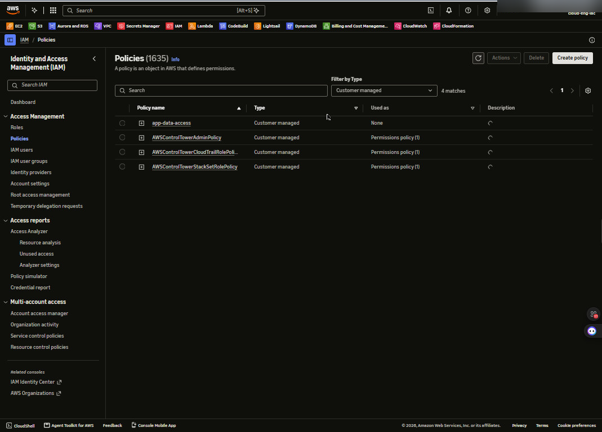
*Day 1: customer managed policies, with app-data-access first in the list.*

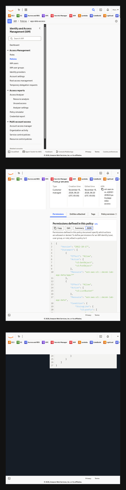
*The app-data-access policy document: S3 object access scoped to the app/ prefix.*

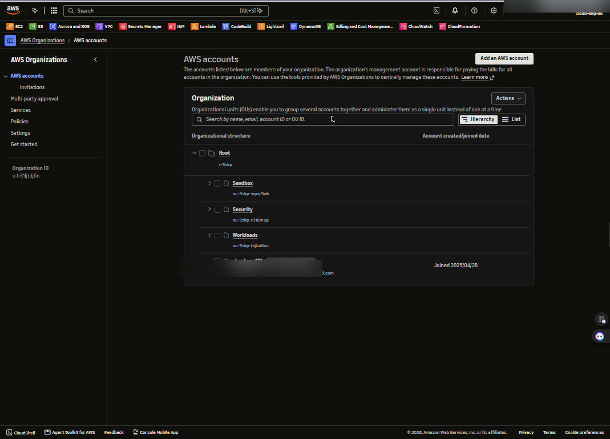
*AWS Organizations: the 7 accounts of org o-h31ljtdj6n.*

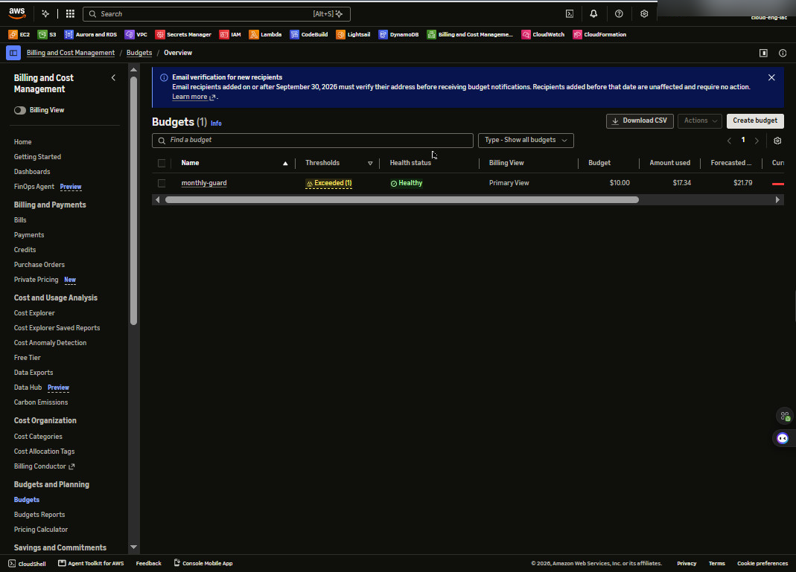
*AWS Budgets: monthly-guard, $10 budget, 80% actual-cost alert, not exceeded.*

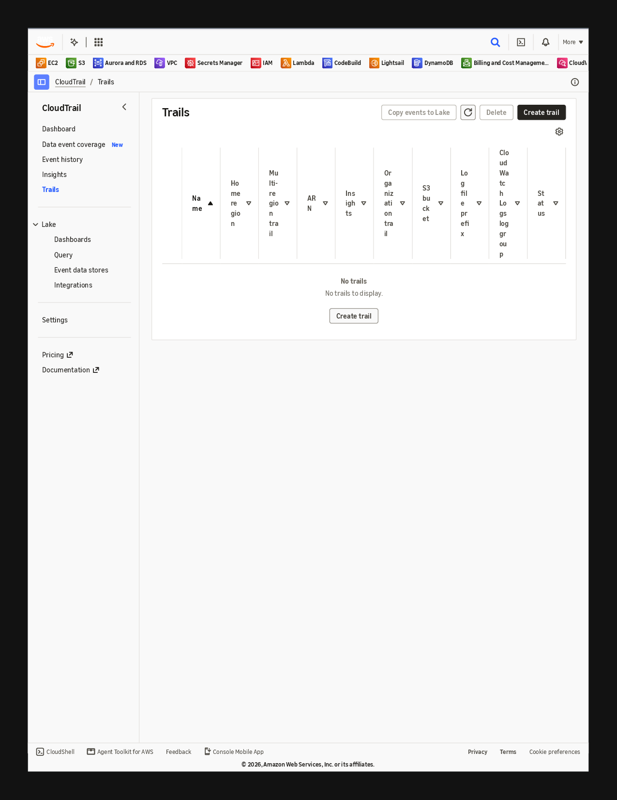
*CloudTrail in this account: no trails configured. Traced 2026-11-16: Day 5's trace step uses the always-on 90-day Event history, so no trail is required for Day 5. Why the organization trail is missing remains an open question, separate from Day 5.*

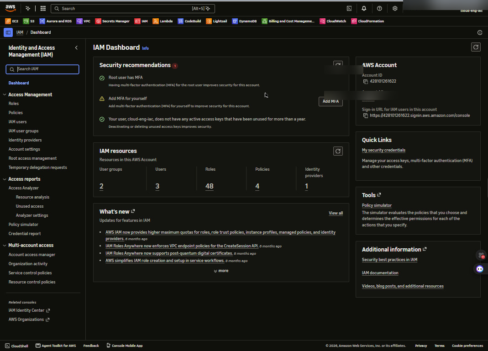
*IAM dashboard: account resources and security recommendations.*

The policy simulator result is not screenshotted: the simulator keeps no history, and its results are recorded in iam/notes.md.


## Day 2 — VPC networking

**Goal:** a 3-tier VPC built from scratch, every route deliberate.

```bash
cd week1/network
VPC=$(aws ec2 create-vpc --cidr-block 10.20.0.0/16 --query Vpc.VpcId --output text --profile lab)
aws ec2 create-tags --resources $VPC --tags Key=Name,Value=lab-vpc --profile lab
# Six subnets, 3 tiers x 2 AZs. Every subnet needs its OWN CIDR:
# reusing one CIDR for both AZs fails with InvalidSubnet.Conflict.
# Public tier (set MapPublicIpOnLaunch on these two after creation)
aws ec2 create-subnet --vpc-id $VPC --cidr-block 10.20.1.0/24 --availability-zone us-east-1a --profile lab
aws ec2 create-subnet --vpc-id $VPC --cidr-block 10.20.2.0/24 --availability-zone us-east-1b --profile lab
# App tier
aws ec2 create-subnet --vpc-id $VPC --cidr-block 10.20.11.0/24 --availability-zone us-east-1a --profile lab
aws ec2 create-subnet --vpc-id $VPC --cidr-block 10.20.12.0/24 --availability-zone us-east-1b --profile lab
# Data tier
aws ec2 create-subnet --vpc-id $VPC --cidr-block 10.20.21.0/24 --availability-zone us-east-1a --profile lab
aws ec2 create-subnet --vpc-id $VPC --cidr-block 10.20.22.0/24 --availability-zone us-east-1b --profile lab
# Internet gateway for public: create AND attach (a detached IGW routes nothing)
IGW=$(aws ec2 create-internet-gateway --query InternetGateway.InternetGatewayId --output text --profile lab)
aws ec2 attach-internet-gateway --internet-gateway-id $IGW --vpc-id $VPC --profile lab
# Flow logs on (non-negotiable habit). CloudWatch destination requires BOTH:
# 1) the log group to exist, and 2) an IAM role the flow-logs service can assume,
# passed as --deliver-logs-permission-arn. Without the role the call fails with
# "DeliverLogsPermissionArn can't be empty if LogDestinationType is cloud-watch-logs".
aws logs create-log-group --log-group-name /vpc/flowlogs --profile lab
cat > flowlogs-trust.json <<'EOF'
{"Version":"2012-10-17","Statement":[{"Effect":"Allow","Principal":{"Service":"vpc-flow-logs.amazonaws.com"},"Action":"sts:AssumeRole"}]}
EOF
cat > flowlogs-perms.json <<'EOF'
{"Version":"2012-10-17","Statement":[{"Effect":"Allow","Action":["logs:CreateLogGroup","logs:CreateLogStream","logs:PutLogEvents","logs:DescribeLogGroups","logs:DescribeLogStreams"],"Resource":"arn:aws:logs:us-east-1:428101261622:log-group:/vpc/flowlogs:*"}]}
EOF
aws iam create-role --role-name w1-flowlogs-role --assume-role-policy-document file://flowlogs-trust.json --profile lab
aws iam put-role-policy --role-name w1-flowlogs-role --policy-name flowlogs-write --policy-document file://flowlogs-perms.json --profile lab
ROLE_ARN=$(aws iam get-role --role-name w1-flowlogs-role --query Role.Arn --output text --profile lab)
aws ec2 create-flow-logs --resource-type VPC --resource-ids $VPC --traffic-type ALL \
  --log-destination-type cloud-watch-logs --log-group-name /vpc/flowlogs \
  --deliver-logs-permission-arn $ROLE_ARN --profile lab

# Route tables: public to IGW, app/data to NAT, data tier no direct internet route back
aws ec2 modify-subnet-attribute --subnet-id subnet-0937b3f3bac28d475 --map-public-ip-on-launch --profile lab
aws ec2 modify-subnet-attribute --subnet-id subnet-06ae6b4b3948ee6c8 --map-public-ip-on-launch --profile lab

```

Steps: build all six subnets, IGW, one NAT (note the cost trade-off of one NAT vs one per AZ), route tables (public to IGW, app/data to NAT, data tier no direct internet route back), security groups per tier (app accepts 443 from public SG only; data accepts 5432/3306 from app SG only), a VPC endpoint for S3, and compare security groups vs NACLs in your notes.

**Prove it:** network diagram in `week1/network/` plus the command log.
**Drill:** "A private instance cannot reach S3. Walk me through your checks." (Route table, endpoint, DNS, SG egress, NACL, in that order.)

### Screenshots (evidence)

Captured 2026-11-16 from the AWS Console. Full checklist: [network/screenshots.md](network/screenshots.md).

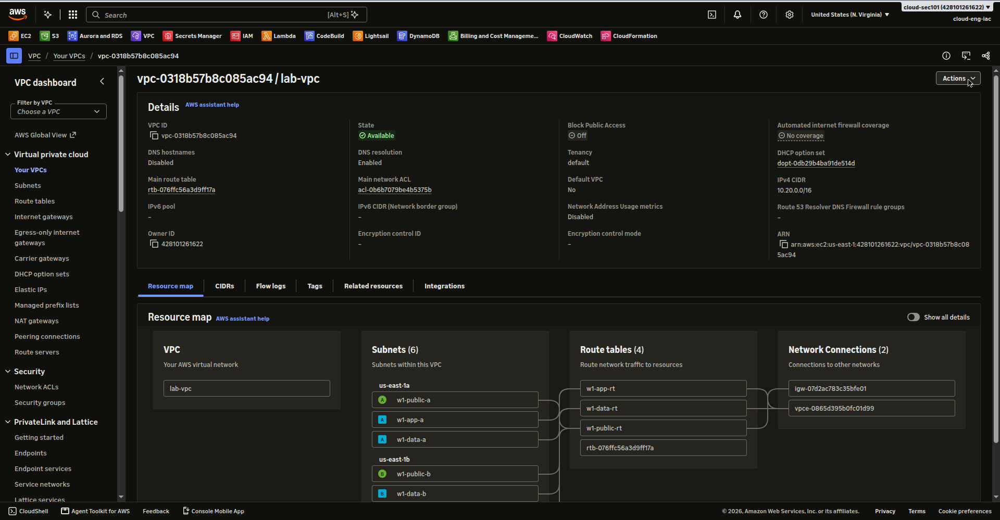
*Day 2: lab-vpc, vpc-0318b57b8c085ac94, CIDR 10.20.0.0/16.*

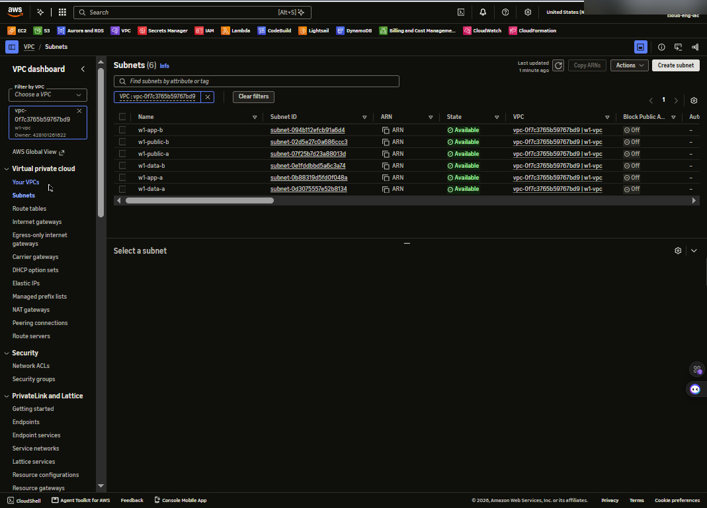
*All six subnets: public, app, and data tiers across us-east-1a and us-east-1b.*

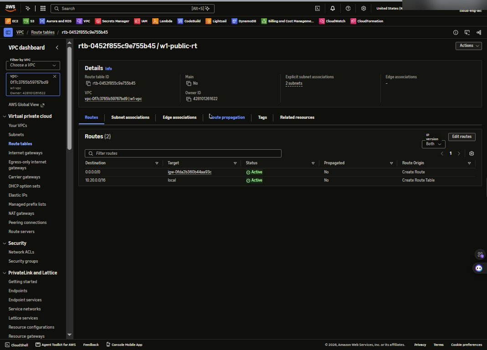
*w1-public-rt: 0.0.0.0/0 to the internet gateway.*

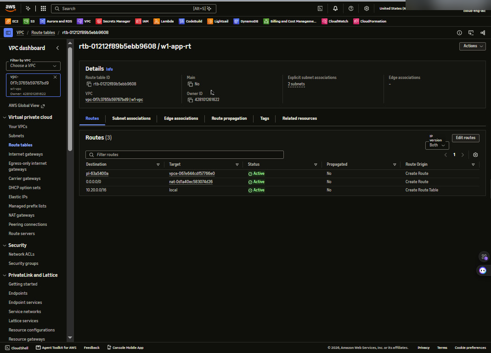
*w1-app-rt: 0.0.0.0/0 to the NAT gateway, plus the S3 prefix-list route via the gateway endpoint.*

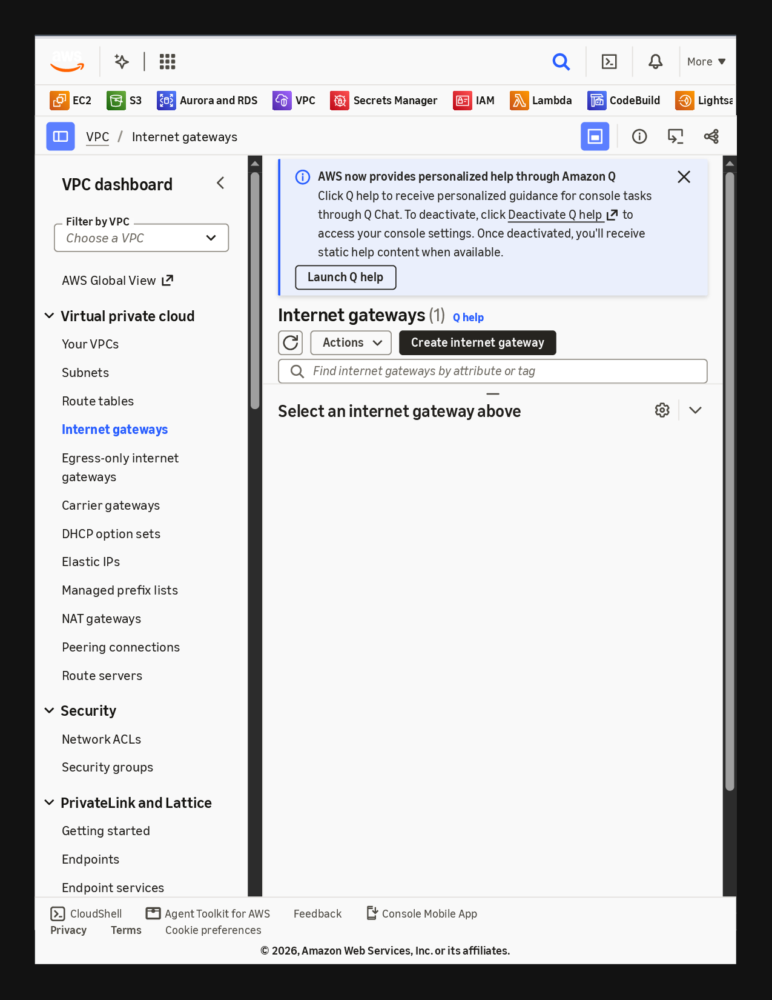
*igw-07d2ac783c35bfe01, Attached to lab-vpc.*

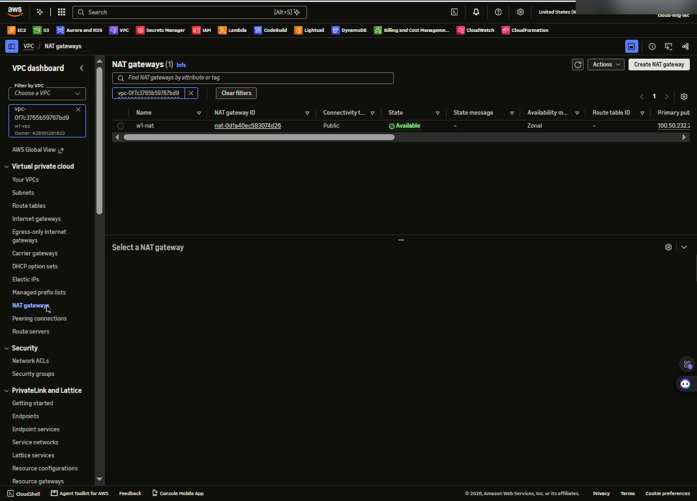
*NAT gateway nat-088b4598c6227185c in w1-public-a, Available, with its Elastic IP.*

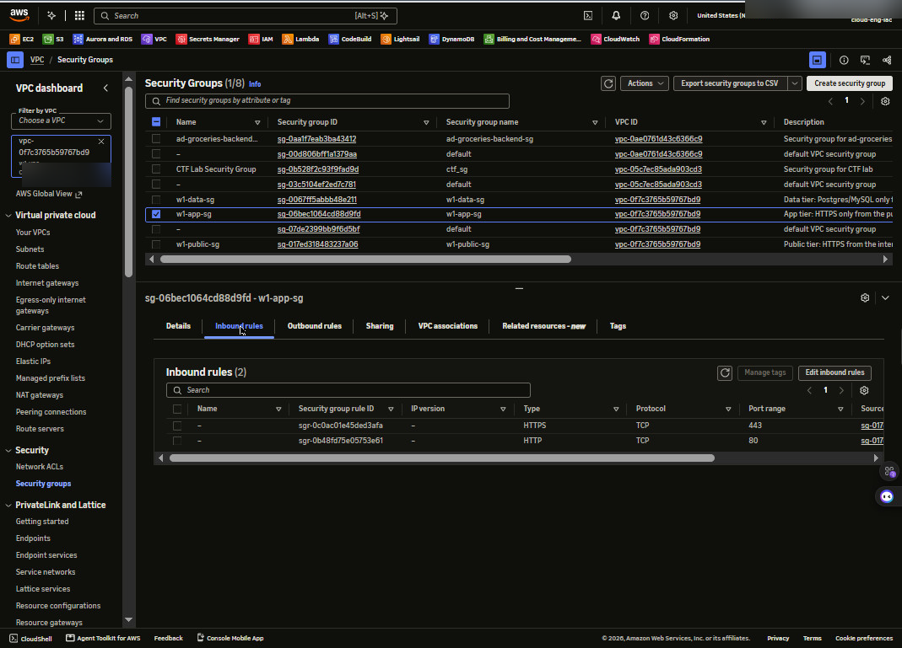
*w1-app-sg inbound: 443 and 80 accepted only from w1-public-sg.*

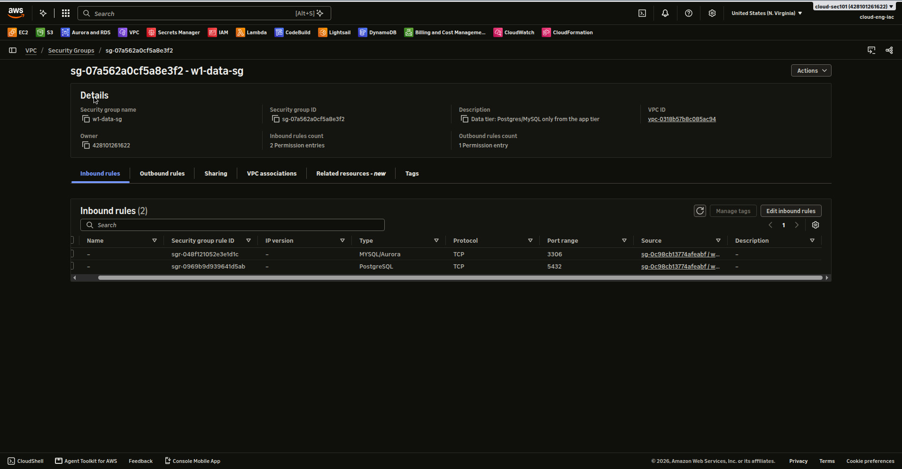
*w1-data-sg inbound: 5432 and 3306 accepted only from w1-app-sg.*

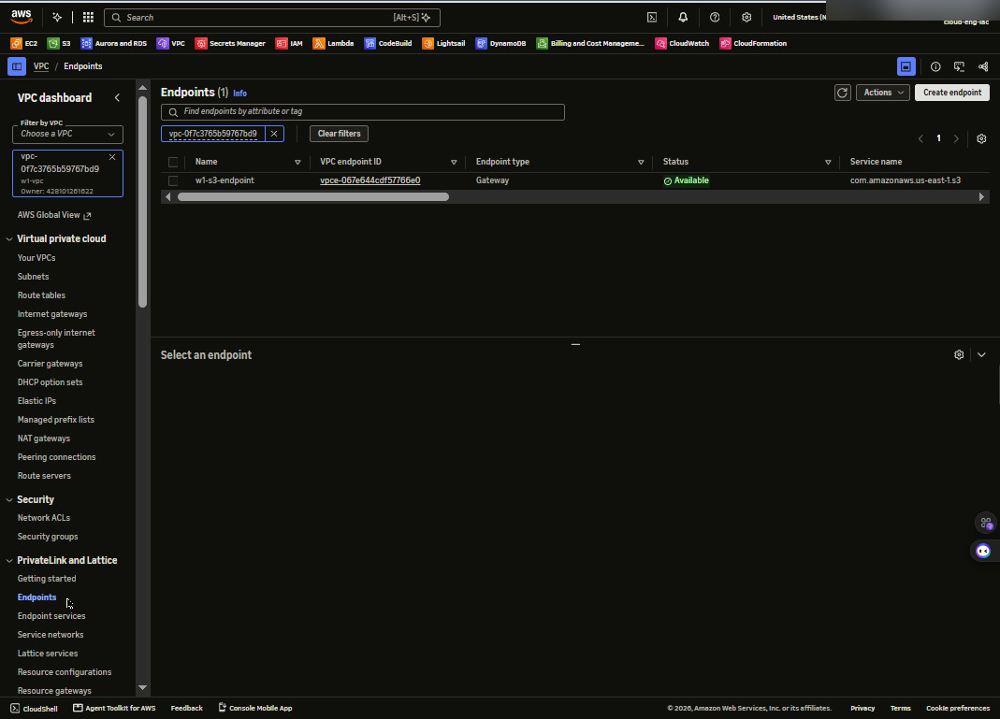
*S3 gateway endpoint vpce-0865d395b0fc01d99, attached to the app and data route tables.*

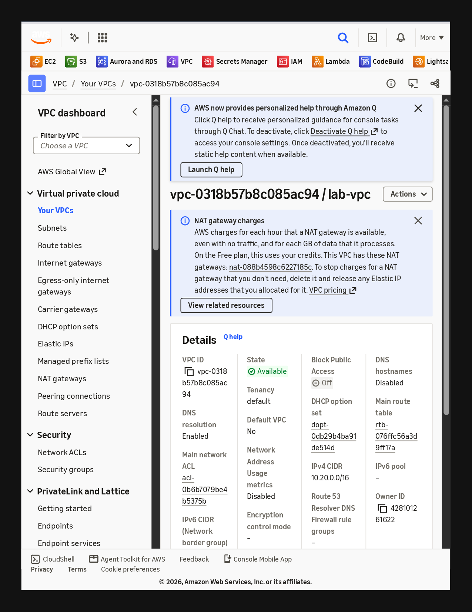
*Flow log fl-0d62187ae88cfecef, Active, delivering to CloudWatch Logs /vpc/flowlogs.*


## Day 3 — Compute and storage

**Goal:** EC2 done properly (user data, IAM role, no keys on the box), an Auto Scaling Group behind a load balancer, and S3 with every protection on.

```bash
cd week1/compute
# First create the three input files the commands below load (the guide originally
# referenced them without ever giving their contents).
cat > ec2-trust.json <<'EOF'
{"Version":"2012-10-17","Statement":[{"Effect":"Allow","Principal":{"Service":"ec2.amazonaws.com"},"Action":"sts:AssumeRole"}]}
EOF
cat > tt.json <<'EOF'
{"PredefinedMetricSpecification":{"PredefinedMetricType":"ASGAverageCPUUtilization"},"TargetValue":50.0}
EOF
# lt-data.json: ImageId is the current Amazon Linux 2023 AMI as of 2026-11-15; refresh it with
# aws ssm get-parameter --name /aws/service/ami-amazon-linux-latest/al2023-ami-kernel-default-x86_64
# UserData (base64) installs httpd and serves a page naming the host.
cat > lt-data.json <<'EOF'
{"ImageId":"ami-096ef200a877f36af","InstanceType":"t3.micro","IamInstanceProfile":{"Name":"ec2-app-profile"},"MetadataOptions":{"HttpTokens":"required","HttpEndpoint":"enabled"},"UserData":"IyEvYmluL2Jhc2gKZG5mIGluc3RhbGwgLXkgaHR0cGQKZWNobyAiaGVsbG8gZnJvbSAkKGhvc3RuYW1lKSAtIHcxIGFwcCB0aWVyIiA+IC92YXIvd3d3L2h0bWwvaW5kZXguaHRtbApzeXN0ZW1jdGwgZW5hYmxlIC0tbm93IGh0dHBkCg==","TagSpecifications":[{"ResourceType":"instance","Tags":[{"Key":"Name","Value":"w1-app"}]}]}
EOF
# IAM role for instances (never access keys on an instance)
aws iam create-role --role-name ec2-app-role --assume-role-policy-document file://ec2-trust.json --profile lab
aws iam attach-role-policy --role-name ec2-app-role --policy-arn arn:aws:iam::aws:policy/AmazonSSMManagedInstanceCore --profile lab
aws iam create-instance-profile --instance-profile-name ec2-app-profile --profile lab
aws iam add-role-to-instance-profile --instance-profile-name ec2-app-profile --role-name ec2-app-role --profile lab
# Launch template with user data that installs and starts a web server
aws ec2 create-launch-template --launch-template-name app-lt --version-description v1 \
  --launch-template-data file://lt-data.json --profile lab
# Target group + ALB + listener + ASG + scaling policy are built by day3-alb-asg.sh
# in this folder (the original text had only <placeholder> values and no commands for
# the target group, ALB, or listener). It needs the Day 2 security groups, so
# week1/network/day2-part2.sh must have run first. It creates target group w1-app-tg,
# ALB w1-alb in the public subnets, an HTTP listener, ASG app-asg (min 2, max 4,
# desired 2) across the app subnets subnet-00a122ab6e0dd98b6 and
# subnet-0d1c54470bab5f591, and the cpu-tt target-tracking policy from tt.json.
bash day3-alb-asg.sh
# S3 with versioning, encryption, lifecycle, and public access blocked — then prove the block
aws s3api create-bucket --bucket derek-lab-app-data --profile lab
aws s3api put-bucket-versioning --bucket derek-lab-app-data --versioning-configuration Status=Enabled --profile lab
aws s3api put-public-access-block --bucket derek-lab-app-data --public-access-block-configuration BlockPublicAcls=true,IgnorePublicAcls=true,BlockPublicPolicy=true,RestrictPublicBuckets=true --profile lab
```

**Prove it:** screenshots and notes in `week1/compute/`; write one line each on S3 durability vs availability and EBS vs instance store.
**Drill:** "Why is the data tier in private subnets if the app needs updates?" (NAT for egress, no inbound route.)

### Screenshots (evidence)

Captured 2026-11-16 from the AWS Console. Full checklist: [compute/screenshots.md](compute/screenshots.md).

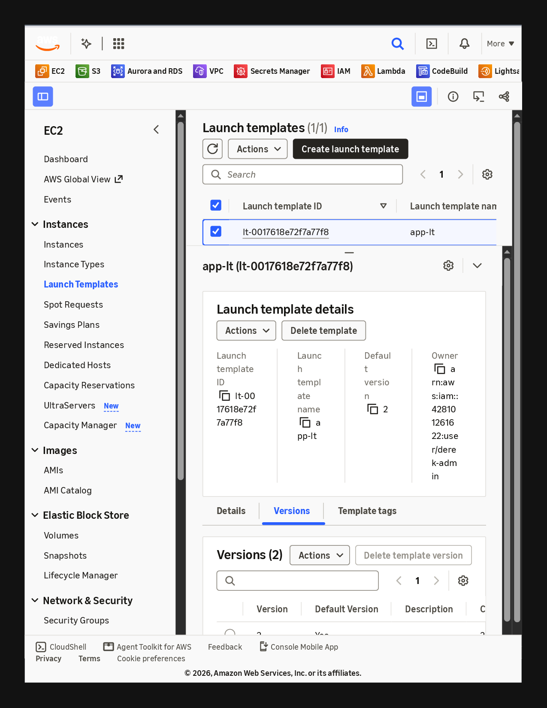
*Day 3: launch template app-lt, version 2 is the default.*

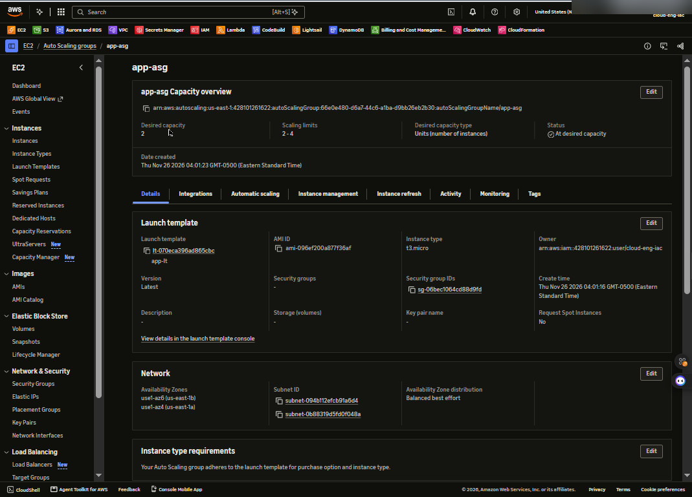
*app-asg: desired 2, min 2, max 4, launch template app-lt.*

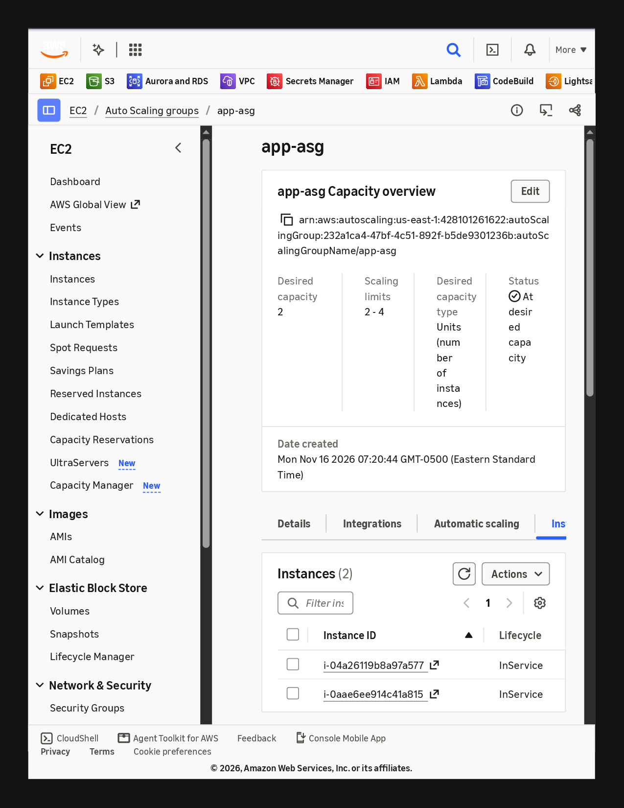
*Both ASG instances InService, one in each AZ.*

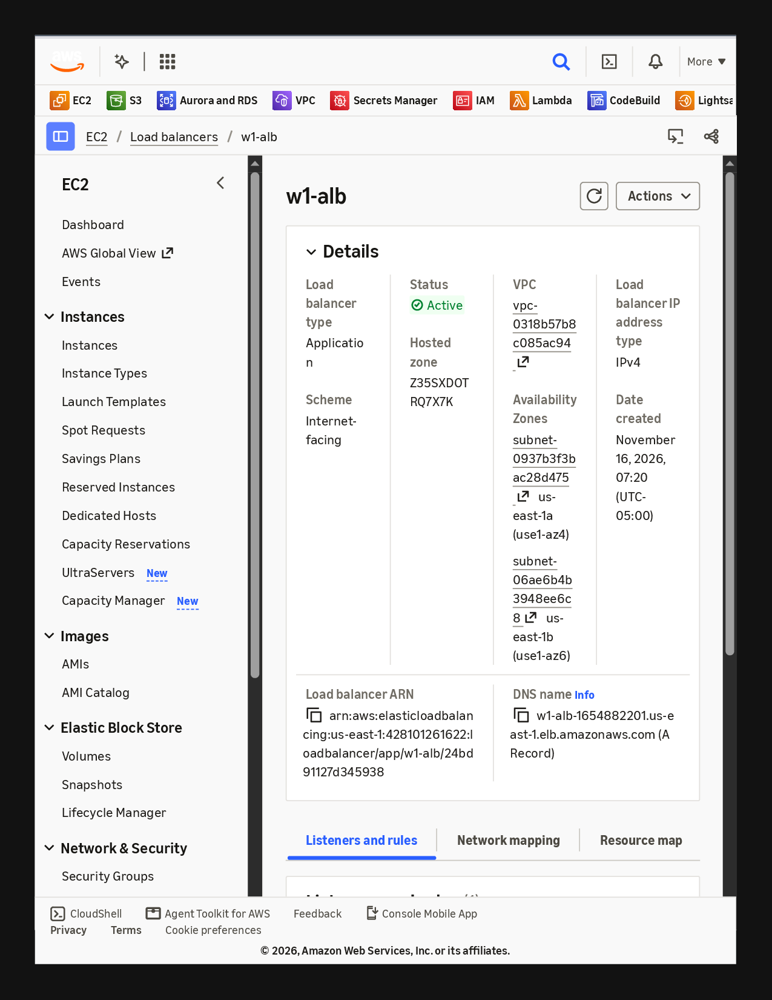
*w1-alb, Active, HTTP 80 listener forwarding to w1-app-tg.*

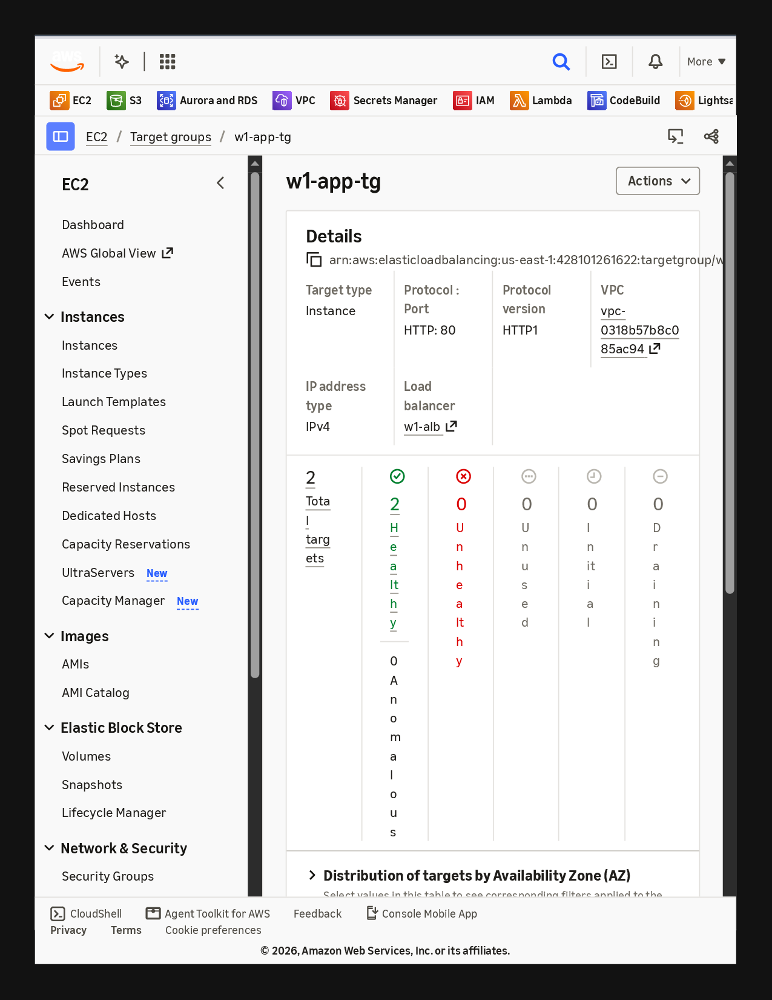
*w1-app-tg: 2 targets, 2 healthy, 0 unhealthy. The day's test result.*

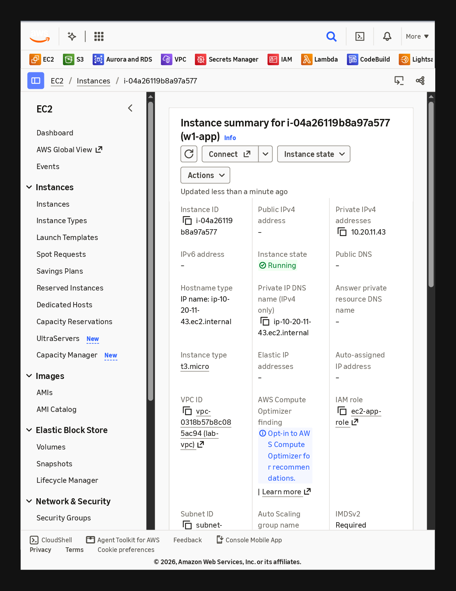
*App instance security: IAM role ec2-app-role attached (via the ec2-app-profile instance profile), and no key pair assigned. No keys on the box.*

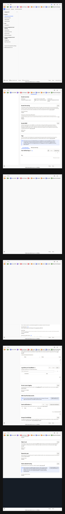
*derek-lab-app-data: bucket versioning Enabled, default encryption SSE-S3.*

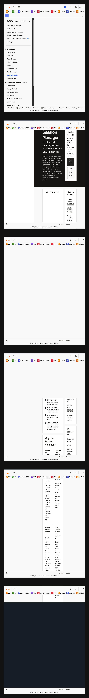
*Systems Manager Session Manager: administration with no SSH port open.*

Not captured: the ALB page itself (checklist item 07). The plain-HTTP ELB address is blocked in the local browser; the ALB was serving both app instances, one per AZ, verified by curl on 2026-11-16.


## Day 4 — RDS and data

**Goal:** RDS where it belongs: private data subnets, Multi-AZ, backups, a read replica, failover tested.

```bash
cd week1/data
# The whole day is scripted in this folder (the original text used <placeholder>
# values for the subnets and security group and ran the replica and failover with
# no waits, which RDS rejects while the primary is still creating):
#   bash day4-rds.sh           subnet group, Multi-AZ primary, read replica, timed failover
#   bash day4-restore-test.sh  snapshot, restore to a test instance, verify, delete it
# Real values used: data subnets subnet-07d372477d86687b6 (us-east-1a) and
# subnet-0bee8403720ad34ad (us-east-1b); data security group sg-07a562a0cf5a8e3f2
# (w1-data-sg, 5432/3306 from the app SG only). Engine pinned to PostgreSQL 15.19,
# the latest 15.x (verified 2026-11-16). The master password (user appadmin) is
# prompted for by the script or read from $DB_MASTER_PASSWORD; it is never written
# to a file. Cost note: Multi-AZ + replica is roughly $1.30/day against the $10
# budget, so delete both instances when the day's tests are done.
```

**Prove it:** a restore runbook note in `week1/data/` (snapshot restore steps, point-in-time recovery, expected timings).
**Drill:** "When is RDS the wrong choice?" (Unstructured data at scale, extreme write throughput, global active-active — and what you would pick instead.)

### Screenshots

Pending: RDS is created and torn down in a single session to protect the $10 budget, so these shots are captured during the run. The checklist is in [data/screenshots.md](data/screenshots.md); the failover event and the restored instance exist only mid-run and are captured then.


## Day 5 — Security and compliance

**Goal:** detection turned on, one deliberate violation, one remediation, evidence both ways.

**Patched 2026-11-16.** The original section could not run as written: it used a `<config-role-arn>` placeholder with no step that creates the Config recorder role, referenced a `s3-encryption-rule.json` file it never provided, never enabled Security Hub, and used a different deliberate violation (an unencrypted bucket) than the prepared lab. The working package lives in `week1/security/`: `day5-security.sh`, `notes.md`, `finding-note.md`, `drill-script-security.md`, `command-log.md`, `screenshots.md`.

```bash
cd week1/security
./day5-security.sh
```

The script enables GuardDuty, AWS Config (recorder plus five managed rules, including restricted-common-ports), Inspector, and Security Hub. It then creates the deliberate misconfiguration: security group `w1-bad-sg` in the Day 2 VPC allowing port 22 from 0.0.0.0/0, plus a throwaway S3 bucket. It stops before remediation so you capture the "before" evidence first: the NON-COMPLIANT Config evaluation for w1-bad-sg, and the CloudTrail Event history entry for its creation (Event history is always on for 90 days, so this step needs no trail; the empty trails list in the management account does not block Day 5). Remediation and the "after" evidence are walked through in `notes.md` and the drill script. Generating sample findings in Security Hub is the one console-only step. Teardown commands are at the end of the script; the deliberate resources are deleted the same day.

**Prove it:** before/after evidence in `week1/security/` (finding-note.md completed, screenshots per screenshots.md).
**Drill:** `drill-script-security.md` word for word, plus tell your Veolia threat-detection story as a STAR answer (GuardDuty, Config, Inspector at 500+ user scale).

## Day 6 — Terraform rebuild

**Goal:** the Day 2–4 stack as code. Remote state, locking, clean apply and destroy.

`week1/terraform/main.tf` (structure; one module per tier as you expand it):

```hcl
terraform {
  required_version = ">= 1.6"
  required_providers { aws = { source = "hashicorp/aws", version = "~> 5.0" } }
  backend "s3" {
    bucket         = "derek-lab-tfstate"
    key            = "week1/terraform.tfstate"
    region         = "us-east-1"
    dynamodb_table = "derek-lab-tflock"
    encrypt        = true
  }
}
provider "aws" { region = "us-east-1" }

module "network" { source = "./modules/network" }   # VPC, subnets, routes, SGs from Day 2
module "compute" { source = "./modules/compute" }   # LT + ASG + ALB from Day 3
module "data"    { source = "./modules/data" }      # RDS from Day 4
```

```bash
cd week1/terraform
# Before init: decide import (Path A) or greenfield (Path B) - the
# Day 2 to 4 stack already exists by hand, so a parallel apply fails
# on unique ALB / ASG / launch template names. The decision, the
# current-state inventory (lab off, NAT deleted on purpose, RDS
# deleted with snapshot app-db-manual-1 kept), and the Prove-it
# checklist are in the Day 6 prep package (notes.md).
bash day6-bootstrap.sh   # state bucket + lock table, check-first
terraform init && terraform fmt -check && terraform validate
terraform plan -out=tfplan   # read it: NAT create expected, no
                             # unexplained destroys
terraform apply tfplan
# Same day, no exceptions: rehearse destroy OR run lab-off and
# record the cost decision in notes.md. Full rate is $75-80/month
# against a $10 budget; the NAT gateway is about $32 of it.
```

**Prove it:** the working Terraform repo (Week 1 checkpoint, part 1).
**Status:** completed 2026-11-24, Path B (greenfield): I tore down the hand-built stack and applied 39 resources fresh under Terraform, verified end to end. Run record: `week1/terraform/notes.md`.


## Day 7 — HA, cost, and Week 1 review

**Goal:** prove the design survives an AZ failure, know what it costs, and close the week honestly.

1. Kill one AZ's instances from the ASG and watch it heal into the other AZ. Note recovery time.
2. Cost pass: open Cost Explorer for the lab account, list the top five resources by cost, and write the tear-down order for anything not part of the checkpoint stack.
3. Finish the one-page architecture diagram (Week 1 checkpoint, part 2) and a half-page self-review: strongest day, weakest day, the question you could not answer.

**Prove it:** diagram + self-review in `week1/`.
**Drill:** re-answer the Day 1 IAM design question and the Day 2 S3 troubleshooting question, cold, recorded.

**Status 2026-11-25: Day 7 completed, Week 1 closed.** I re-applied
the Day 6 stack (39 resources) and turned the lab on. HA test: I
removed us-east-1a from the ASG; the ASG replaced the lost instance
inside us-east-1b in 37 seconds, full healthy capacity returned in
3m31s, and the ALB never stopped answering (evidence:
week1/checkpoint/ha-test.log). Security Hub, scored from the CLI:
Foundational 80%, overall 76% (the Day 5 baseline caveat and the CIS
console-only note are in week1/checkpoint/notes.md). Cost pass:
November to date $16.37 against the $10 budget, top cost the ALB,
then EC2-Other and AWS Config. Diagram and self-review are in
week1/; the drill script is in week1/checkpoint/. I destroyed the
stack the same day and verified it gone (state 0, snapshot kept,
recorder stopped). Working files: week1/checkpoint/.

---

# WEEK 2 — AZURE + IaC: SMARTLEAD ON AZURE (Days 8–14)

Per the 2026-11-14 Plan Update, this week's checkpoint changed. **New checkpoint:** SmartLead running on Azure Container Apps, deployed by Terraform (azurerm) from its own repo, with a VNet, private endpoints, Key Vault secrets delivered by managed identity, one Azure Policy, a PostgreSQL + Redis data layer, a GitHub Actions deployment, and Scaling Write-Up v1. SmartLead's real data stays local; Azure gets seed/test data only. Billing alerts on before Day 8; tear down paid Azure resources the same day unless a step says otherwise.

Working repo for the week: `week2/smartlead-on-azure/` (its own GitHub repo, `smartlead-on-azure`).

## Day 8 — Azure refresh + Terraform on Azure

**Goal:** azurerm Terraform with remote state, planning cleanly against your subscription.

```bash
az login && az account show --query "{sub:id, name:name}" -o table
az group create -n rg-smartlead -l eastus2
# Remote state in Azure Storage
az storage account create -n stderektfstate -g rg-smartlead -l eastus2 --sku Standard_LRS --min-tls-version TLS1_2
az storage container create -n tfstate --account-name stderektfstate
```

`week2/smartlead-on-azure/terraform/backend.tf`:

```hcl
terraform {
  required_version = ">= 1.6"
  required_providers { azurerm = { source = "hashicorp/azurerm", version = "~> 3.100" } }
  backend "azurerm" {
    resource_group_name  = "rg-smartlead"
    storage_account_name = "stderektfstate"
    container_name       = "tfstate"
    key                  = "smartlead.tfstate"
  }
}
provider "azurerm" { features {} }
```

```bash
cd week2/smartlead-on-azure/terraform
terraform init && terraform plan   # empty plan against the new resource group is the day's bar
```

**Learn:** Microsoft Learn AZ-104 refresh (VNets, private endpoints) and the Container Apps docs (environments, ingress, revisions, scale rules).
**Drill:** "Walk me through VNet design for a three-tier app on Azure," from your bootcamp three-tier project.

## Day 9 — Network first

**Goal:** the network in Terraform before any app lands on it.

`network.tf` (core resources; extend with NSG rules per tier):

```hcl
resource "azurerm_virtual_network" "main" {
  name                = "vnet-smartlead"
  location            = azurerm_resource_group.main.location
  resource_group_name = azurerm_resource_group.main.name
  address_space       = ["10.30.0.0/16"]
}
resource "azurerm_subnet" "infra" {  # Container Apps environment subnet (delegated, /23 minimum)
  name                 = "snet-infra"
  resource_group_name  = azurerm_resource_group.main.name
  virtual_network_name = azurerm_virtual_network.main.name
  address_prefixes     = ["10.30.0.0/23"]
  delegation {
    name = "aca"
    service_delegation { name = "Microsoft.App/environments" actions = ["Microsoft.Network/virtualNetworks/subnets/join/action"] }
  }
}
resource "azurerm_subnet" "endpoints" {
  name                 = "snet-endpoints"
  resource_group_name  = azurerm_resource_group.main.name
  virtual_network_name = azurerm_virtual_network.main.name
  address_prefixes     = ["10.30.4.0/24"]
}
```

Add: NSGs per subnet, a Private DNS zone for PostgreSQL (`privatelink.postgres.database.azure.com`) linked to the VNet, and the private endpoint on Day 12. Decide internal vs external Container Apps environment and write the trade-off in the repo README.

**Prove it:** network diagram in the repo (extend the bootcamp three-tier diagram).
**Drill:** "How do private endpoints change how an app talks to its database?" (DNS resolves to a private IP; traffic never leaves the VNet; public access can be disabled outright.)

## Day 10 — SmartLead onto Container Apps

**Goal:** your FastAPI app running on the platform the target roles name.

SmartLead already runs in Docker locally. Confirm the image builds, then:

```bash
az acr create -n acrdereksmartlead -g rg-smartlead --sku Basic --admin-enabled false
az acr build --registry acrdereksmartlead --image smartlead:latest ./app-src   # or docker build + push
```

`app.tf` (essentials):

```hcl
resource "azurerm_container_app_environment" "main" {
  name                       = "cae-smartlead"
  location                   = azurerm_resource_group.main.location
  resource_group_name        = azurerm_resource_group.main.name
  infrastructure_subnet_id   = azurerm_subnet.infra.id
}
resource "azurerm_container_app" "smartlead" {
  name                         = "ca-smartlead"
  container_app_environment_id = azurerm_container_app_environment.main.id
  resource_group_name          = azurerm_resource_group.main.name
  revision_mode                = "Single"
  identity { type = "SystemAssigned" }   # used on Day 11
  template {
    min_replicas = 1
    max_replicas = 3                       # revisited on Day 13 after load data
    container {
      name   = "smartlead"
      image  = "acrdereksmartlead.azurecr.io/smartlead:latest"
      cpu    = 0.5
      memory = "1Gi"
    }
  }
  ingress {
    external_enabled = true
    target_port      = 8000
    traffic_weight { percentage = 100 latest_revision = true }
  }
}
```

Grant the environment's identity `AcrPull` on the registry (or use the ACR admin-free pull via managed identity), `terraform apply`, and hit the app URL.

**Prove it:** running revision URL + `az containerapp show` output saved in the repo.
**Drill:** "Container Apps, AKS, or ECS: how do you choose?" Answer from this deployment.

## Day 11 — Identity and secrets, the Azure way

**Goal:** no secret in code, in the repo, or in plain environment configuration. The app's managed identity reads Key Vault.

```hcl
resource "azurerm_key_vault" "main" {
  name                      = "kv-derek-smartlead"
  location                  = azurerm_resource_group.main.location
  resource_group_name       = azurerm_resource_group.main.name
  tenant_id                 = data.azurerm_client_config.current.tenant_id
  sku_name                  = "standard"
  enable_rbac_authorization = true
  purge_protection_enabled  = false   # lab only; say why in the note
}
# The container app's identity gets Secrets User (read only, nothing more)
resource "azurerm_role_assignment" "app_kv" {
  scope                = azurerm_key_vault.main.id
  role_definition_name = "Key Vault Secrets User"
  principal_id         = azurerm_container_app.smartlead.identity[0].principal_id
}
```

Steps: create the vault, move every SmartLead secret into it (`az keyvault secret set`), rewire the app to read secrets via its identity at startup, delete the secrets from local config, and grep the repo to prove none remain (`git grep -i "password\|secret" -- ':!*.md'`). Then assign one Azure Policy to the resource group and show it evaluating:

```bash
az policy assignment create -n deny-public-ip --policy "<policy-definition-id>" \
  --scope /subscriptions/<sub>/resourceGroups/rg-smartlead --enforcement-mode Default
az policy state list --resource-group rg-smartlead --query "[?complianceState=='NonCompliant']" -o table
```

**Prove it:** a "Secrets handling" note in the repo: what moved, what the identity can and cannot read, the grep evidence.
**Drill:** "How do you keep secrets out of code in Azure?" Now a story, not a definition.

## Day 12 — A real data layer: PostgreSQL + Redis

**Goal:** SmartLead off SQLite and onto the data layer the job descriptions name.

```bash
az postgres flexible-server create -n psql-smartlead -g rg-smartlead -l eastus2 \
  --admin-user smartleadadmin --admin-password "<from-your-password-manager>" \
  --sku-name Standard_B1ms --version 15 --vnet vnet-smartlead --subnet snet-data \
  --private-dns-zone <your-zone-id> --yes
az redis create -n redis-smartlead -g rg-smartlead -l eastus2 --sku Basic --vm-size C0
```

Steps: add a data subnet (`10.30.8.0/24`, delegated to `Microsoft.DBforPostgreSQL/flexibleServers`) and the private endpoint/DNS from Day 9's groundwork; run SmartLead's existing Alembic migrations against PostgreSQL (`alembic upgrade head` with the new `DATABASE_URL`); set the pool deliberately in the app config and write down the numbers:

```python
# app/db.py — explicit pool settings, sized for the Day 14 load test
engine = create_async_engine(
    settings.database_url,
    pool_size=10,        # steady connections per replica
    max_overflow=5,      # burst headroom before requests queue
    pool_timeout=30,     # seconds a request waits for a connection before failing
    pool_recycle=1800,   # recycle connections every 30 min
)
```

Add Redis as a cache-aside layer on the app's hottest read path: check Redis first, on a miss read PostgreSQL and populate with a short TTL. Record one before/after latency reading for that endpoint.

**Prove it:** migration output + the before/after cache note in the repo.
**Drill:** "What happens to a FastAPI service under load when the database connection pool is too small?" (Requests queue on the pool, latency climbs, then timeouts — you will see it tomorrow.)

## Day 13 — Pipeline and scale rules

**Goal:** the Veolia pipeline pattern, Azure target; scaling set by evidence, not defaults.

`.github/workflows/deploy.yml`:

```yaml
name: deploy-smartlead
on:
  push: { branches: [main] }
permissions: { id-token: write, contents: read }
jobs:
  deploy:
    runs-on: ubuntu-latest
    steps:
      - uses: actions/checkout@v4
      - uses: azure/login@v2
        with:
          client-id: ${{ secrets.AZURE_CLIENT_ID }}
          tenant-id: ${{ secrets.AZURE_TENANT_ID }}
          subscription-id: ${{ secrets.AZURE_SUBSCRIPTION_ID }}
      - name: Build and push
        run: |
          az acr build --registry acrdereksmartlead --image smartlead:${{ github.sha }} ./app-src
      - name: Deploy new revision
        uses: azure/container-apps-deploy-action@v1
        with:
          containerAppName: ca-smartlead
          resourceGroup: rg-smartlead
          imageToDeploy: acrdereksmartlead.azurecr.io/smartlead:${{ github.sha }}
```

Federated (OIDC) login, no stored Azure password: that is the point of the `azure/login` setup. Then add scale rules to the Terraform template block:

```hcl
http_scale_rule {
  name                = "http-concurrency"
  concurrent_requests = 50        # new replica per 50 concurrent requests
}
```

Keep min replicas 1, max 3 until Day 14 gives you real numbers.

**Prove it:** a green pipeline run + the scale rules in Terraform.
**Drill:** "Tell me about a time you scaled a system." You finish building the honest project version of this answer tomorrow.

## Day 14 — Load test, break it, Week 2 checkpoint

**Goal:** evidence. What breaks first, what one change fixes, what the numbers do.

`loadtest/locustfile.py`:

```python
from locust import HttpUser, task, between

class LeadUser(HttpUser):
    wait_time = between(0.5, 2)
    @task(3)
    def list_leads(self):
        self.client.get("/api/leads")
    @task(1)
    def create_lead(self):
        self.client.post("/api/leads", json={"name": "Load Test", "email": "load@example.com", "source": "locust"})
```

```bash
pip install locust
locust -f loadtest/locustfile.py --host https://<your-container-app-url> --headless -u 50 -r 5 -t 5m --csv loadtest/run1
# Watch in parallel: az containerapp replica list, Azure Monitor metrics, DB connections
```

Steps: ramp 10 → 50 → 100 users; record where it degrades (app CPU, pool exhaustion, Redis hit rate, cold starts). Change exactly one thing (pool size, scale threshold, or cache coverage), rerun, record the difference.

**Prove it (Week 2 checkpoint):** the repo holds the Terraform module with remote state, the network diagram, the secrets note, the pipeline, and **Scaling Write-Up v1**: what broke, what you changed, what the numbers did, in your own words.
**Drill:** deliver the scaling story out loud in two minutes. Record it.

---

# WEEK 3 — KUBERNETES, CONTAINERS, CI/CD (Days 15–21)

One small app carries the whole week: containerized on Day 15, deployed on Day 16, broken on Day 17, scaled on Day 18, secured on Day 19, pipelined on Day 20, GitOps-managed on Day 21. Use SmartLead's API or a small Python service of your own. Lab: your 3-node cluster (k8s-control-plane, k8s-worker-1, k8s-worker-2, 172.16.10.0/24).

## Day 15 — Docker refresher: a small, safe image

**Goal:** a production-shaped image: multi-stage, non-root, scanned, pinned.

```dockerfile
# Dockerfile
FROM python:3.12-slim AS build
WORKDIR /app
COPY requirements.txt .
RUN pip install --no-cache-dir --prefix=/install -r requirements.txt

FROM python:3.12-slim
RUN useradd --create-home appuser
WORKDIR /app
COPY --from=build /install /usr/local
COPY app/ ./app/
USER appuser
EXPOSE 8000
HEALTHCHECK CMD python -c "import urllib.request; urllib.request.urlopen('http://localhost:8000/health')"
CMD ["uvicorn", "app.main:app", "--host", "0.0.0.0", "--port", "8000"]
```

```bash
cd week3/docker
docker build -t derekowusubekoe/lab-app:1.0.0 .
trivy image derekowusubekoe/lab-app:1.0.0        # or: docker scout cves
docker push derekowusubekoe/lab-app:1.0.0        # record this exact reference; Day 16 deploys this string
```

**Prove it:** Dockerfile, `.dockerignore`, and scan summary in `week3/docker/`, plus the pushed image reference written down.

## Day 16 — Kubernetes core on your lab

**Goal:** a proper deployment, not `kubectl run`: deployment, service, config, secrets, namespaces, resource limits.

```bash
vagrant up   # from the lab folder on Windows PowerShell, per your lab setup
kubectl get nodes   # all three Ready before deploying anything; save this baseline
kubectl create namespace lab
```

`week3/k8s/deployment.yaml` (essentials):

```yaml
apiVersion: apps/v1
kind: Deployment
metadata: { name: lab-app, namespace: lab }
spec:
  replicas: 2
  selector: { matchLabels: { app: lab-app } }
  template:
    metadata: { labels: { app: lab-app } }
    spec:
      containers:
        - name: app
          image: derekowusubekoe/lab-app:1.0.0   # the exact Day 15 reference
          ports: [{ containerPort: 8000 }]
          resources:
            requests: { cpu: "100m", memory: "128Mi" }
            limits:   { cpu: "500m", memory: "512Mi" }
          readinessProbe: { httpGet: { path: /health, port: 8000 }, initialDelaySeconds: 5 }
          livenessProbe:  { httpGet: { path: /health, port: 8000 }, initialDelaySeconds: 15 }
          envFrom: [{ configMapRef: { name: lab-app-config } }, { secretRef: { name: lab-app-secret } }]
```

```bash
kubectl apply -f week3/k8s/
kubectl -n lab get pods,svc,endpoints
kubectl -n lab rollout status deploy/lab-app
```

**Prove it:** manifests and README in `week3/k8s/`, the healthy-nodes baseline, and a successful rollout output.

## Day 17 — Troubleshooting: break it three ways

**Goal:** timed, evidence-based diagnosis. No guessing; every fix names the evidence that found it.

```bash
# Break 1: wrong image tag
kubectl -n lab set image deploy/lab-app app=derekowusubekoe/lab-app:9.9.9
kubectl -n lab describe pod <pod> | grep -A5 Events     # ImagePullBackOff; find it, restore the Day 15 reference
# Break 2: bad config (point the app at a dead database URL via the ConfigMap)
kubectl -n lab logs <pod>                                # CrashLoopBackOff with the app's own error
# Break 3: resource starvation (drop the memory limit below what the app needs)
kubectl -n lab describe pod <pod> | grep -i oom          # OOMKilled in Last State
# Your toolkit all day: get, describe, logs, events, top
kubectl -n lab get events --sort-by=.lastTimestamp | tail -20
```

Optional Break 4 (per the guide): a Service selector that matches nothing; endpoints empty is the tell.

**Prove it:** a troubleshooting log in the repo: each break, the evidence, the fix, the time it took.

**Plan Update addition (one Build block today or Day 18): FastAPI production patterns.** In SmartLead: make I/O endpoints async, confirm the Day 12 pool settings hold under the Day 14 load profile, and add graceful degradation: if Redis is unreachable, fall back to PostgreSQL and stay up. Add three sentences to Scaling Write-Up on consistency, caching, and back-pressure, only where the app actually demonstrates them.

## Day 18 — Helm, ingress, autoscaling under your own load

**Goal:** the Day 16 manifests as a chart, traffic through an ingress, and an HPA that reacts to load you generate.

```bash
cd week3/helm
helm create lab-app
# Replace the chart templates with your Day 16 manifests, templated (image, replicas, resources in values.yaml)
helm install lab-app ./lab-app -n lab
# Ingress (ingress-nginx if not present)
helm repo add ingress-nginx https://kubernetes.github.io/ingress-nginx && helm repo update
helm install ingress-nginx ingress-nginx/ingress-nginx -n ingress-nginx --create-namespace
kubectl apply -f ingress.yaml
# HPA on CPU
kubectl -n lab autoscale deploy/lab-app --cpu-percent=60 --min=2 --max=6
# Generate load and watch it scale
kubectl -n lab run loadgen --image=busybox --restart=Never -- sh -c "while true; do wget -qO- http://lab-app/health; done"
kubectl -n lab get hpa --watch
kubectl -n lab delete pod loadgen
```

**Prove it:** the Helm chart in `week3/helm/`, the HPA definition, and before/during/after scaling numbers.

## Day 19 — Kubernetes security: RBAC, policies, secrets

**Goal:** least privilege inside the cluster, matching the Day 1 and Day 11 pattern.

```bash
# A service account that can read pods in one namespace and nothing else
kubectl apply -f week3/k8s/rbac.yaml
kubectl auth can-i list pods --as=system:serviceaccount:lab:lab-reader -n lab        # yes
kubectl auth can-i delete pods --as=system:serviceaccount:lab:lab-reader -n lab      # no
kubectl auth can-i list secrets --as=system:serviceaccount:lab:lab-reader -n kube-system  # no
```

```yaml
# rbac.yaml — Role + RoleBinding (namespace-scoped, read-only)
apiVersion: rbac.authorization.k8s.io/v1
kind: Role
metadata: { name: lab-reader, namespace: lab }
rules:
  - apiGroups: [""]
    resources: ["pods", "services"]
    verbs: ["get", "list", "watch"]
---
apiVersion: rbac.authorization.k8s.io/v1
kind: RoleBinding
metadata: { name: lab-reader-binding, namespace: lab }
subjects: [{ kind: ServiceAccount, name: lab-reader, namespace: lab }]
roleRef: { kind: Role, name: lab-reader, apiGroup: rbac.authorization.k8s.io }
```

Add: a NetworkPolicy that lets only the ingress namespace reach the app pods; Pod Security Standards labels on the namespace (`kubectl label ns lab pod-security.kubernetes.io/enforce=baseline`) and fix what admission flags (your Day 15 image already runs non-root — prove it matters); move the Day 16 secret value out of any file in Git history you control and document the rotation.

**Prove it:** RBAC manifests, NetworkPolicy, `can-i` outputs, and before/after security notes in `week3/k8s/`.

## Day 20 — Managed cluster + CI/CD pipeline

**Goal:** the same app on a managed cluster (EKS or AKS, one small node, time-boxed), shipped by a pipeline, then torn down.

```bash
# AKS (fast to create and delete; EKS equivalent in the guide)
az aks create -n aks-lab -g rg-smartlead --node-count 1 --node-vm-size Standard_B2s --generate-ssh-keys
az aks get-credentials -n aks-lab -g rg-smartlead
helm install lab-app week3/helm/lab-app -n lab --create-namespace
# Prove it runs, screenshot it, then:
az aks delete -n aks-lab -g rg-smartlead --yes --no-wait
```

Pipeline (`.github/workflows/week3-pipeline.yml`): on push, build the image, run the Day 15 scan, push with the commit SHA as the tag, and `helm upgrade` the lab cluster. A red pipeline must block the deploy; prove that once by pushing a broken build on purpose.

**Prove it:** pipeline file in `week3/pipeline/`, green-run evidence, managed-cluster screenshot, and the teardown confirmation.

## Day 21 — GitOps + Week 3 review

**Goal:** the cluster reconciles itself from Git. Your hands stay off `kubectl apply` for the app.

```bash
# Argo CD on the lab cluster
kubectl create namespace argocd
kubectl apply -n argocd -f https://raw.githubusercontent.com/argoproj/argo-cd/stable/manifests/install.yaml
kubectl apply -f week3/gitops/application.yaml   # points Argo at week3/helm/lab-app in your repo
# The test: change replicas in values.yaml, commit, watch Argo sync. No manual deploy.
```

**Prove it (Week 3 checkpoint):** GitOps configuration in `week3/gitops/`, the commit-only change syncing on its own, and a re-run of one Day 17 break, cold, timed against your Day 17 log.

**Plan Update addition (Prove it, once this week): the comparison note.** One page in the repo: Container Apps vs AKS vs ECS for a small production API — cost shape, operational burden, scaling model, when each wins. You have now run all three styles (ECS and EKS at Veolia; Container Apps in Week 2; AKS today).

---

# WEEK 4 — OBSERVABILITY, SECURITY, DESIGN, SUPPORT (Days 22–28)

## Day 22 — Observability: signals tied to user impact

**Goal:** structured logs, a dashboard that answers "are users hurting?", one SLO, alerts that mean something.

1. Convert the lab app's logging to structured JSON (no print-style unstructured logs) and redeploy through the Day 21 GitOps path, not by hand.

```python
# app/logging_config.py — one JSON line per request, with the fields you will alert on
import logging, sys
handler = logging.StreamHandler(sys.stdout)
handler.setFormatter(logging.Formatter(
    '{"level":"%(levelname)s","msg":"%(message)s","path":"%(path)s","status":"%(status)s","ms":"%(ms)s"}'))
```

2. Build the dashboard (your lab stack's tool, or Azure Monitor for the Week 2 deployment): request rate, error rate, p50/p95 latency, saturation (CPU, DB connections).
3. Write one SLO in plain words (for example, 99.5% of requests succeed over 30 days) and the alert that fires when its burn rate says users are hurting, not when a server is merely busy.
4. First-look note: given only this dashboard, what do you check first for (a) errors up, latency flat; (b) latency up, errors flat.

**Plan Update addition (Datadog, Build block):** start a Datadog trial and instrument the SmartLead-on-Azure deployment (logs and metrics first, APM if time allows). Build the same four-panel dashboard there (request rate, latency percentiles, error rate, replica count, DB connections) and two alerts: error rate and p95 latency, each with a note on why that threshold.

**Prove it:** dashboard screenshot, SLO note, one alert notification received, and the first-look note in `week4/observability/`.

## Day 23 — Incident simulation: a timed on-call shift

**Goal:** run an incident end to end, with timestamps, like the ones you led at Veolia.

1. Inject a fault without telling yourself which one (pick from a sealed list, or have the fault be Day 17's Break 2 or 3 on the managed stack; per the Plan Update, the Datadog version: kill the Redis cache or set the DB pool to 1 on the Azure deployment).
2. Open the Day 22 dashboard first. Write a timeline entry for every action, with a timestamp. Impact first, cause second.
3. Post two status updates during the incident, written for a non-technical reader: what is affected, what you are doing, when the next update comes.
4. Fix, then prove recovery with the same health and error checks from Day 22.

**Prove it:** post-incident review in `week4/observability/` with the timeline, the saved status updates, and recovery evidence. Blameless, specific, with one prevention action that has an owner (you) and a date.

## Day 24 — Cloud security scenarios: three tabletops

**Goal:** one-page playbooks for three scenarios, each with its fastest detection source and first three actions.

1. **Compromised access key.** Detect (GuardDuty/CloudTrail anomaly), contain (disable the key, tighten the role to the Day 19 least-privilege pattern), hunt for persistence (new users, new keys, new policies).
2. **Public storage exposure.** Detect (Config rule / Access Analyzer), contain (block public access), assess (access logs: was it read?).
3. **Crypto-mining instance.** Detect (GuardDuty finding, cost anomaly), contain (isolate the security group, snapshot for forensics, terminate).

Each playbook gets the Day 23 discipline: timestamps, one communicator, status updates on a cadence.

**Prove it:** three one-page playbooks in `week4/security/`.

## Day 25 — System design I: secure file upload for 10,000 users

**Goal:** a 20-minute whiteboard design, recorded, with trade-offs defended.

Design: secure file upload and download for 10,000 users. Hit, in order: requirements and scale estimates; the diagram (client, CDN or direct-to-S3 presigned URLs, API, metadata store, virus scanning, storage tiers); security (presigned URL expiry, encryption at rest and in transit, IAM boundaries, audit logging); failure modes; cost shape. Record yourself presenting it in 20 minutes, then write a self-review naming your three weakest moments.

**Prove it:** diagram + recording + self-review in `week4/design/`.

## Day 26 — System design II: migrate an on-prem app with minimal downtime

**Goal:** migrate a customer-data application like the Veolia billing and workforce systems. This is Day 1 and Day 8 wearing a migration jacket.

Design: phased migration (rehost vs replatform, and why); data migration with a cutover window and a tested rollback point; identity done right (new least-privilege roles, no big-bang permission copy); hypercare monitoring on the Day 22 dashboard pattern; the exact point after which rollback stops being possible, named out loud. Record the 20-minute presentation; self-review as on Day 25.

**Prove it:** diagram, recording, and self-review in `week4/design/`. Days 25–26 together are your design portfolio.

## Day 27 — Application support excellence: three runbooks

**Goal:** three runbooks a smart teammate could run at 3 AM without you.

1. **App down after a config change.** Symptoms, first checks (what changed, when), the rollback step, verification, escalation line.
2. **Database connections exhausted.** Symptoms (the Day 12/14 pool story is your reference), where to look, the safe restart or pool action, the permanent fix.
3. **Certificate expired.** Symptoms, how to confirm in one command (`echo | openssl s_client -connect host:443 2>/dev/null | openssl x509 -noout -dates`), renewal path, the monitoring gap that let it happen.

Runbook format: title, symptoms, impact, checks in order, fix, verify, escalate. Cold-test one of them: follow it literally, as if you did not write it, and correct every step that fails the test.

**Prove it:** three runbooks in `week4/runbooks/`, one cold-tested with its corrections visible.

## Day 28 — Behavioral + scripting sprint

**Goal:** six STAR stories under two minutes each, then scripting under a timer.

The six stories (from the guide): the incident you led (Day 23's structure on a real Veolia case); the deployment win (45% manual deployment time cut); the Ansible library across 100+ servers; a difficult stakeholder moment; a mistake and what changed after it; the scaling story (Day 14's write-up, project-honest).

Scripting sprint (45 minutes, timed): write a Python script that reads a log file, counts errors by type, and prints a sorted report; then a Bash one-liner version of the same count.

```python
# sprint/log_report.py
import re, sys
from collections import Counter
pat = re.compile(r"\b(ERROR|WARN|CRITICAL)\b")
counts = Counter()
with open(sys.argv[1]) as f:
    for line in f:
        m = pat.search(line)
        if m: counts[m.group(1)] += 1
for level, n in counts.most_common():
    print(f"{level}: {n}")
```

```bash
grep -oE '\b(ERROR|WARN|CRITICAL)\b' app.log | sort | uniq -c | sort -rn
```

**Prove it:** six recorded stories (phone is fine) + both scripts in `week4/`.

---

# CAPSTONE + INTERVIEW LAUNCH (Days 29–30)

Per the Plan Update, the capstone is no longer a new project. **SmartLead-on-Azure is the capstone.** These two days finish and present it.

## Day 29 — Finish and publish the capstone

1. **README** in `smartlead-on-azure`: what it is, the architecture diagram, how to deploy it (the Terraform and pipeline from Week 2), and how to tear it down.
2. **Scaling Write-Up, final version:** Day 14's v1 updated with Week 3's patterns work and Week 4's incident findings. What broke, what changed, the numbers, in your words.
3. **The comparison note** (from Day 21): Container Apps vs AKS vs ECS, included in the repo.
4. **The three stories, practiced aloud once today:** the scaling story, the secrets story (Day 11), the incident story (Day 23 on the real Veolia case, with the Day 23 drill as rehearsal). Day 30 uses these.
5. Pin the repo on your GitHub profile.

**Prove it:** public capstone repo, pinned, with diagram, runbook, rollback note, and the write-ups.

## Day 30 — Mock interviews + launch

1. **Mock 1 (technical, 45 min):** design a system (Day 25 or 26 pattern, unseen variant), then defend the capstone's trade-offs for 15 minutes.
2. **Mock 2 (behavioral + support, 45 min):** the six STAR stories, plus a live troubleshooting scenario run Day 17 style.
3. Score both honestly against the questions you missed. Write the drill list: your three weakest answers, verbatim, become a weekly drill list after Day 30.
4. Update the resume and LinkedIn with the capstone link and the Week 2–4 artifacts. The CHAOS-tailored resume in `~/workspace/job-search/reviews/` is the pattern: evidence first, coursework labelled as coursework.

**Prove it:** two completed mocks with scores, the drill list, and the updated resume and LinkedIn carrying the capstone.

## After Day 30

Certification renewal, in this order (from the program): **AWS Solutions Architect Associate first** (expired 07/2025; SAA-C03, 65 questions, 720/1000 to pass), **then AZ-104** (expired 08/2024), **then Security+ in January 2027**. Keep the weekly drill list running, one mock a week, and keep applying in parallel: the fleet's rule stands, resume review against each job description before any application, and nothing submitted without your approval.

## Progress checklist

- [ ] Setup: tools, accounts, billing alerts, repo
- [ ] Week 1: Days 1–7 — checkpoint: Terraform VPC + EC2 + RDS repo + diagram
- [ ] Week 2: Days 8–14 — checkpoint: SmartLead on Container Apps + Scaling Write-Up v1
- [ ] Week 3: Days 15–21 — checkpoint: GitOps-managed app + comparison note
- [ ] Week 4: Days 22–28 — checkpoint: runbook, post-incident review, two design recordings, six STAR stories
- [ ] Days 29–30: capstone published, two mocks done, drill list written
