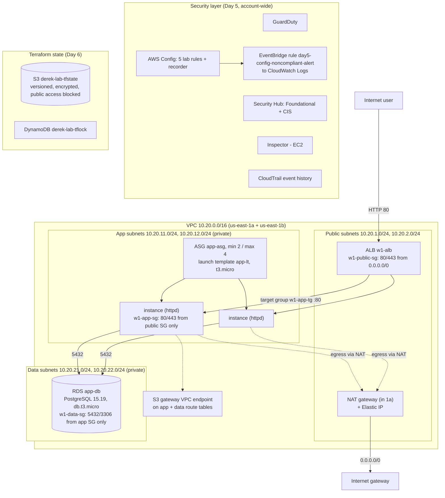

# Week 1 architecture — the checkpoint stack

One page. The three-tier design I built by hand on Days 1-4, secured
on Day 5, rebuilt with Terraform on Day 6, and failure-tested on
Day 7.
Account: AWS lab (us-east-1). VPC w1-vpc, 10.20.0.0/16.

## How to read it
- Traffic enters only through the ALB. App instances sit in private
  subnets, take traffic only from the public security group, and reach
  the internet outbound through one NAT gateway (needed for package
  installs; proven on Day 7 when the replacement instance's user data
  installed httpd with no inbound path).
- The data tier takes connections only from the app security group and
  is never public. RDS was restored from the Day 4 manual snapshot
  (app-db-manual-1) on both Terraform builds.
- S3 traffic from the private tiers stays off the internet through the
  gateway endpoint.
- The Day 5 security layer watches the whole account, not just this
  stack: GuardDuty, Security Hub, Inspector, Config rules, and an
  EventBridge alert on any Config noncompliance.
- Day 7 proved the shape: with us-east-1a removed, the ASG replaced the
  lost instance inside us-east-1b in 37 seconds, full healthy capacity
  in 3m31s, and the ALB never stopped answering.
